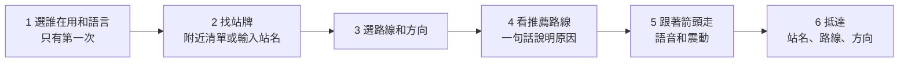

# 01 · 產品規格

## 服務定義

**一句話：** 看不懂地圖的人，選好要搭的公車，跟著一支箭頭走到正確的站牌。

| 題目方向 | 我們怎麼做 |
|---|---|
| 圖像化指引 | 把地圖換成一支箭頭，轉動手機時箭頭跟著轉 |
| 易讀設計 | 導航畫面只有站名、箭頭、距離和一句話 |
| 多語服務 | 繁中、英、泰、越、印尼、柬埔寨、日、韓 |
| 分齡介面 | 長者、兒童、外籍人士共用同一個畫面，用設定調整字級、語速和句子 |

| 對象 | 情境 | 目前的困難 |
|---|---|---|
| 長者 | 到陌生地方後要搭公車回家 | 看不懂地圖方向，分不清站牌在馬路哪一側，怕階梯和陡坡 |
| 兒童 | 第一次自己走到站牌 | 看不懂地圖，常用字以外的句子也不一定看得懂 |
| 外籍人士 | 知道要搭哪一路，看不懂中文站名 | 同名站牌有好幾個，分不出方向 |

## 差異化

1. **走到對的站牌：** 依路線和方向，指向正確的站位，同名站位分開列。
2. **不用看地圖：** 箭頭、語音、震動就夠了。
3. **路線會配合使用者（階段 2）：** 依對象和時間推薦路線，並說明原因。

## 成功標準

1. 第一次使用：從打開服務到開始走，不超過 6 步；之後跳過第 1 步。
2. 主流程在實機上連續跑 3 次都沒有錯誤。
3. 戶外走一條 200 公尺以上的真實路線，抵達提示出現時離站牌不超過 30 公尺。
4. 8 種語言切換後都不破版；手機沒有該語音時，改用文字和震動。
5. 沒有定位、羅盤或網路時，畫面會說明原因和下一步，不會白屏。
6. 2 分鐘內可以示範完主流程，並且可以立刻重來。

## 範圍

| 階段 | 功能 |
|---|---|
| **階段 1（23:00）** | 選對象和語言；附近站牌與搜尋；選路線和方向；看路線（只有標準步行）；箭頭導航；語音與震動；走偏重算；抵達畫面；模擬行走；關於頁；服務置頂於城市通 |
| **階段 2（03:00）** | 長者少階梯少坡；晚上較亮；兒童少過無燈路口；推薦原因；看其他路線；模擬晚上開關。來不及就移除該情境 |
| **留到之後** | 到站時間、地圖、家人 QR、求助按鈕、只輸入目的地、今日施工、隊友新技術（先看 [07](07-adding-tech.md)） |
| **不做** | 車上下車提醒、室內導航、AR 鏡頭畫面、帳號、新北市公車資料 |

主要入口是**附近站牌清單**，不是輸入框，因為目標使用者可能連打字都有困難。

## 主流程



## 畫面

| 代號 | 路由 | 內容 | 例外狀態 |
|---|---|---|---|
| P1 開始 | `/welcome` | 選「長者／兒童／外籍人士」，再選語言。存在手機 | 選過就跳過；設定頁可改 |
| P2 找站牌 | `/` | 附近站牌大按鈕清單（預設 500 公尺）；輸入站名入口；設定 | 定位中顯示進度；定位失敗改引導輸入站名；附近沒有站牌時建議輸入站名 |
| P3 搜尋 | `/search` | 大輸入框、結果清單 | 沒有結果時提示換個站名；API 失敗可重試 |
| P4 選路線 | `/station/:uid` | 同名站位分開列，每項有路線、往哪裡、距離、行進方向 | 查不到資料時回到搜尋 |
| P5 路線 | `/route` | 推薦路線的距離和時間；一句話原因；「開始走」；「看其他路線」（階段 2） | 只有一條路時不顯示「看其他路線」；路線算不出來時說明並可重試 |
| P6 導航 | `/nav` | 見下方「導航畫面」 | 見下方狀態表 |
| P7 抵達 | `/arrived` | 打勾、站名、路線、方向、「完成」 | 無 |
| P8 關於 | `/about` | 理念、對象、資料來源與更新時間、架構圖、開源套件、翻譯確認狀態 | 不做成投影片樣式 |
| P9 設定 | `/settings` | 改對象、語言、語音開關 | 無 |

## 導航畫面

風格參考 Apple「尋找」App 的精確尋找畫面：**滿版單色背景、一支大箭頭、幾乎沒有其他東西**。箭頭和版面要用我們自己畫的，不要複製別家產品的圖示。

```text
┌────────────────────────┐
│ 城市通 AppBar（App 的） │  ← App 提供，標題用 document.title
├────────────────────────┤
│ 範例站                  │  站名
│ 307 往範例終點          │  路線和方向
│                        │
│                        │
│          ▲             │  大箭頭，旋轉，寬度約 60vw
│         ███            │
│         ███            │
│                        │
│ 120 公尺                │  距離（沿路線剩餘）
│ 往這走                  │  一句話
│                        │
│ (×)                (🔊) │  結束／語音開關，只有這兩顆
└────────────────────────┘
```

| 元素 | 規格 |
|---|---|
| 背景 | 整個 WebView 區域單色，見下方狀態表 |
| 文字與箭頭 | 白色 |
| 站名 | 至少 24px |
| 路線和方向 | 至少 18px |
| 箭頭 | 寬度約 60vw；只用 `transform: rotate()`；要走最短方向轉動（[04](04-nav-logic.md)） |
| 距離 | 至少 56px。100 公尺以上取到 10 公尺；10–100 公尺取到 5 公尺；不到 10 公尺顯示「快到了」 |
| 一句話 | 至少 26px，最多兩行 |
| 按鈕 | 白色圓形，直徑至少 64px，有 `aria-label`；避開手機底部安全區 |
| 不要放 | 地圖、路線清單、ETA、分享、選單、資料來源 |

| 狀態 | 背景 | 箭頭 | 大字 | 一句話 |
|---|---|---|---|---|
| `locating`、`routing` | Grayscale 800 `#30383D` | 隱藏，顯示進度 | | 正在找你的位置／正在找路 |
| `navigating` | Primary 700 `#356C77` | 實心 | 距離 | 往這走、向左轉…… |
| `weak_signal` | Secondary 800 `#74521B` | 空心，指最後目標 | 定位不太準 | 請到空曠一點的地方 |
| `rerouting` | Secondary 800 | 空心 | 走偏了 | 正在重新找路 |
| `back_to_route` | Secondary 800 | 實心，指最近路線點 | 距離 | 請回到剛才的路 |
| 沒有羅盤資料 | Secondary 800 | 隱藏 | 抓不到方向 | 請拿著手機畫 8 字；語音和距離繼續 |
| `arrived` | 深綠 `#27500A` | 換成打勾 | 到了 | 在這裡等 307 |
| `failed` | Grayscale 800 | 隱藏 | 原因 | 下一步，並提供按鈕 |

- 白字對比：Primary 700 為 5.9:1、Secondary 800 為 7.1:1、深綠為 9.4:1。**不要用 Primary 500 `#5AB4C5`**，白字只有 2.4:1。
- UI Kit 沒有綠色，深綠是抵達專用的自訂色，寫進 tokens，不要用在別處。
- 狀態不能只靠顏色：一定會換文字，走偏時箭頭也會變空心。
- `?demo=1` 時左上角顯示小標籤「模擬」。
- App 的 AppBar 留著，不改 App。`document.title` 要設成短短的服務名稱。

## 對象設定

對象是**設定，不是三套畫面**。元件只讀 `audience.ts` 這一份設定。

| 項目 | 長者 | 兒童 | 外籍人士 |
|---|---|---|---|
| 字級倍率 | 1.2 | 1.1 | 1.0 |
| 語速 | `slow` | `normal` | `normal` |
| 句子 | 短句、一次一件事 | 用簡單字、搭配圖示、抵達時有鼓勵語 | 所選語言的短句 |
| 預設語言 | zh-TW | zh-TW | 依手機語言，沒有對應時 en |
| 候選路線（階段 2） | 少階梯少坡 | 少過無燈路口 | 最快 |

## 語言

| 語言 | 代碼 | 介面文字 | 語音 |
|---|---|---|---|
| 繁體中文 | `zh-TW` | 隊員撰寫 | 手機有內建 |
| 英文 | `en` | 隊員確認 | 手機有內建 |
| 泰文、越南文、印尼文、日文、韓文 | `th`、`vi`、`id`、`ja`、`ko` | 預先翻譯，需人工確認 | 看手機有沒有語音包 |
| 柬埔寨文 | `km` | 預先翻譯，需人工確認 | 很可能沒有，改用文字加震動 |

- 翻譯**預先放進語言檔**，執行時不呼叫翻譯服務，也不用 LLM。
- 句子不寫死在元件，全部走 `web/src/i18n/`。句型用參數，例如 `{distance} 公尺`。
- 沒有人能確認的語言，要在關於頁標示「尚未由母語者確認」，發表時也要誠實說明。
- 站名：`zh-TW` 顯示中文；`en` 顯示英文，沒有英文就顯示中文；其他語言顯示「英文＋中文」（TDX 只有這兩種）。
- 泰文和柬埔寨文的字高較大，每種語言都要在 375px 寬實測。手機沒有字型時要內嵌 Noto 字型（SIL OFL）。

## 易讀規則

以下是起始值，實機檢視後可調整，但要全站一致。

- 一般畫面：白底深字，內文至少 20px；主要按鈕高度至少 64px，間距至少 12px。
- 對比至少 4.5:1；內文盡量到 7:1。
- 每個畫面只有一個主要動作。
- 不用術語。寫「過馬路」「紅綠燈」，不寫「穿越」「號誌」。
- 顏色不是唯一的訊息來源。
- 配色和元件跟隨 Town Pass UI Kit，375px 寬不能破版；文字放大 200% 仍可讀（無障礙 DT）。
- 所有 API 呼叫都有載入中、空資料、錯誤畫面。

## 文案範例

| 情境 | 中文 | English |
|---|---|---|
| 直走 | 往這走 | Go this way |
| 小角度 | 稍微向左 | Bear left |
| 轉彎 | 向左轉 | Turn left |
| 轉彎前 | 前面路口向左轉 | Turn left ahead |
| 向後轉 | 請向後轉 | Please turn around |
| 走偏 | 走偏了，正在重新找路 | Off route. Finding a new way |
| 訊號弱 | 定位不太準，請到空曠一點的地方 | Location is weak. Move to an open area |
| 抵達 | 到了，在這裡等 307 | You're here. Wait for bus 307 |
| 兒童抵達 | 你做到了！在這裡等 307 | You did it! Wait for bus 307 |
| 開始走 | 請注意來車和紅綠燈 | Watch for cars and traffic lights |

推薦原因的文案見 [02](02-route-candidates.md)。

## 不存的資料

服務不需要帳號，也不讀 `userinfo`。對象、語言和語音開關只存在手機的 localStorage。位置只用來即時計算，不寫入資料庫，也不進 log。詳見 [ADR-0005](architecture/decisions/0005-keep-location-out-of-urls-and-logs.md)。
