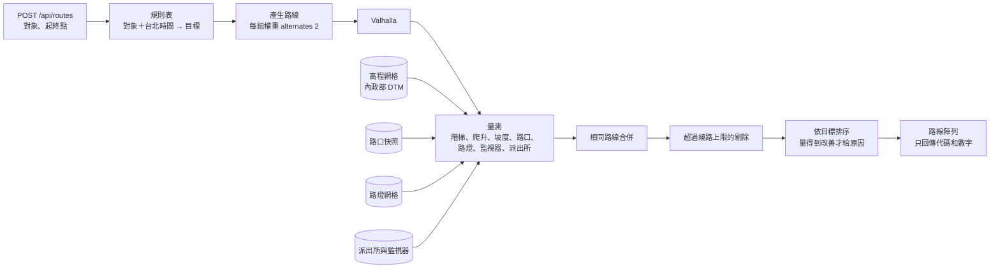
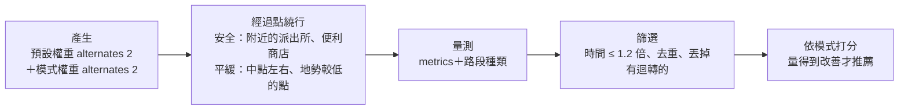

# 02 · 候選路線

後端依**使用者類型和時間**先產生一批路線，全部量測後，依「目標」挑出推薦的一條，並用一句話說明原因。

- **階段 1：** 只算標準步行，但回應格式已經是路線陣列。
- **階段 2：** 依下面的規則表挑路線。合約的形狀不變，只多了幾個量測欄位和原因代碼（[03](03-contracts.md)）。
- 2026-11-07 17:10 改版：加入內政部 DTM 坡度、監視器、派出所，見 [改版 spec](../superpowers/specs/2026-11-07-any-place-slope-safety-design.md)。

## 情境規則表

規則放在單一設定檔 `api/app/route_rules.py`，隊友調整時只改這裡。

| 對象 | 時間 | 推薦目標 | 比較用 |
|---|---|---|---|
| 長者 | 白天 | `flattest` | `fastest` |
| 長者 | 晚上 | `flattest_watched` | `fastest` |
| 兒童 | 白天 | `fewer_unsignalized_watched` | `fastest` |
| 兒童 | 晚上 | `fewer_unsignalized_watched_bright` | `fastest` |
| 外籍人士 | 白天 | `fastest` | 無 |
| 外籍人士 | 晚上 | `watched_bright` | `fastest` |

- **時間：** 由後端用台北時間判斷。晚上的起始定義是 18:00–06:00，放在設定檔。
- **Demo：** 白天要展示晚上，前端傳 `simulate: "night"`，畫面要標示「模擬晚上」。
- 監視器和派出所用在**晚上全部對象＋兒童全天**；長者白天只看坡度和階梯。

## 算法

Valhalla 不能直接偏好某些點（監視器、派出所），所以不是「一組權重算一次」，而是**先產生、再量測、再挑選**。



1. **產生：** 依下面的「目標」表，每個目標用 1–3 組 Valhalla pedestrian costing，每組要 `alternates: 2`。Valhalla 回的替代路線可能比要求少，不能假設筆數。
2. **量測：** 每條路都算 [量測欄位](#量測欄位)。
3. **去重：** 兩條路的距離差不到 5%，而且 80% 以上的路線點距離對方不到 15 公尺，就算相同。
4. **繞路上限：** 超過上限的路線**不參加挑選**。
   - 目標名稱有 `watched`：比最快路線**多 20% 以內，且不超過 200 公尺**。
   - 其他：多 300 公尺以內，且不超過 1.5 倍。
   - 都是起始值，放在設定檔。
5. **挑選：** 依「目標」表的順序排序，取第一條。
6. **原因：** **只有量得到改善才給原因代碼**。挑出來的路和最快路線相同，或一個原因都沒有，就推薦最快路線並加 `no_better_route`。
7. **重算：** `candidate` 有值時，只產生並挑選那個目標。

### 目標

| 目標 | 產生路線用的權重 | 挑選順序 |
|---|---|---|
| `fastest` | 預設 | 主路線 |
| `flattest` | 少坡＋少階梯；預設 | 爬升 → 階梯段數 → 最陡坡度 → 距離 |
| `flattest_watched` | 少坡＋少階梯；少坡＋少階梯＋較亮；預設 | 爬升（差 2 公尺內視為相同）→ 監視分數 → 距離 |
| `fewer_unsignalized_watched` | 少過無燈路口；預設 | 無燈路口數 → 監視分數 → 距離 |
| `fewer_unsignalized_watched_bright` | 少過無燈路口＋較亮；預設 | 無燈路口數 → 監視分數（含路燈）→ 距離 |
| `watched_bright` | 預設；較亮；偏好人行道 | 監視分數（含路燈）→ 距離 |

**監視分數** = 每 100 公尺的監視器數 + 2 ×（路線 150 公尺內的派出所數）；目標名稱有 `bright` 時再加 3 × `litRatio`。係數放在 `route_rules.py` 頂部，是起始值。

長者的所有路線都用 `walking_speed` 3.5 km/h 估時間，其他對象用預設 5.1 km/h。

### 權重（起始值）

| 名稱 | 參數 |
|---|---|
| 預設 | `walkway_factor` 1.0、`sidewalk_factor` 1.0、`alley_factor` 2.0、`driveway_factor` 5.0、`use_hills` 0.5、`use_lit` 0 |
| 少階梯 | `step_penalty` 120、`elevator_penalty` 0 |
| 少坡 | `use_hills` 0.0。**要 V4 通過**（routing 用 DTM 重建）才有效；沒通過時這組和預設幾乎相同，靠 `alternates` 和自己的量測挑選 |
| 較亮 | `use_lit` 0.8，`alley_factor` 3 |
| 少過無燈路口 | `sidewalk_factor` 0.8、`walkway_factor` 0.9、`alley_factor` 3、`driveway_factor` 8 |
| 偏好人行道 | `sidewalk_factor` 0.7、`alley_factor` 3 |

名稱相加就是參數疊加，例如「少坡＋少階梯＋較亮」。

### 量測欄位

| 欄位 | 算法 |
|---|---|
| `steps` | 路線上 `stairs` 的段數 |
| `climbM` | 每 20 公尺從高程網格雙線性取值；累計上升，但要比上一個低點高出 1 公尺以上才算（濾掉網格雜訊）；取到 0.1 |
| `maxGradePct` | 40 公尺視窗內最大的（高差 ÷ 40）× 100，取到 0.1 |
| `litRatio` | 每 20 公尺取一點，附近 30 公尺內有路燈的比例 |
| `unsignalizedCrossings`、`signalCrossings`、`unknownCrossings` | 路線 8 公尺內各類路口數 |
| `cameras` | 路線 **50 公尺**內的監視器數。監視器座標是地址對照出來的，只準到巷口或數十公尺，30 公尺會漏掉大半；半徑是 `metrics.py` 的 `CAMERA_BUFFER_M` |
| `policeNearby` | 路線 150 公尺內的派出所數；同一地址的分局與派出所只算一個 |

快照不存在時對應欄位是 `null`，不丟例外。`null` 的欄位不能拿來給原因。

## 資料

| 用途 | 來源 | 欄位 | 備註 |
|---|---|---|---|
| 站位 | TDX 公車 `StopOfRoute`、`Station`、`Route` | `StopUID`、`StopName`、`StopPosition`、`Bearing`、`StationID`、`StopBoarding` | 腳本產生快照，執行時不需要 TDX 金鑰 |
| 公車首末班 | TDX 公車 `Schedule`（臺北市） | `Timetables`、`Frequencys`、`ServiceDay` | 同一支腳本；回程沒有班表時借去程的時間，**是估計值** |
| 捷運 | TDX 捷運 `Station`、`StationOfRoute`、`StationOfLine`、`Line`、`S2STravelTime`、`LineTransfer`、`StationExit`、`Frequency`、`FirstLastTimetable`（臺北捷運 TRTC、新北捷運 NTMC 的環狀線） | 站名、座標、出口、站間行車時間、換線時間、班距、首末班 | `scripts/build_metro_index.py` → `metro_index.json`；行車、候車、換線時間都是**估計值**，不是即時班表 |
| 目的地地址 | OpenStreetMap Nominatim | 地址、地標 → 座標 | 前端直接呼叫，**使用者輸入的目的地會送到 OSM Nominatim**；遵守其使用規範（每秒最多 1 次） |
| 地點 | OpenStreetMap（Overpass，臺北範圍） | `name`、`name:en`、`amenity`、`shop`、`tourism`、`leisure`、`office`、`healthcare`、車站 | `scripts/build_places.py` → `api/data/places.json`；格式見 [03](03-contracts.md) |
| 路網、階梯 | OpenStreetMap `taiwan-latest.osm.pbf`（328 MB） | `highway=steps` 約 6,271 段 | 裁切成臺北範圍再建圖 |
| 有紅綠燈的路口 | OpenStreetMap | `crossing=traffic_signals` 約 7,549 個 | |
| 沒有紅綠燈的路口 | OpenStreetMap | `crossing=uncontrolled`、`crossing=unmarked` 約 1,813 個 | |
| 其他路口 | OpenStreetMap | 其他 `highway=crossing` 約 7,428 個 | **算「不確定」** |
| 路燈 | [臺北市路燈位置分布圖](https://data.gov.tw/dataset/128270) | `TWD97X`、`TWD97Y`，148,135 筆，51 MB | TWD97 轉 WGS84，建置時轉成網格 |
| 道路照明標籤 | OpenStreetMap `lit` | 約 14,843 條 | Valhalla `use_lit` 使用 |
| **高程** | [內政部 20 公尺網格數值地形模型](https://data.gov.tw/dataset/35430)（政府資料開放授權第 1 版） | 平面坐標＋高程；坐標系看 `schema_hdr.csv`（預期 TWD97） | `scripts/build_elevation.py` 裁切臺北，產生 `api/data/elevation_grid.bin`＋`.json`（量測用），以及 `routing/elevation/N24E121.hgt`、`N25E121.hgt`（Valhalla 用，V4） |
| **派出所** | [臺北市政府警察局名稱及地址](https://data.gov.tw/dataset/130095)（政府資料開放授權第 1 版） | `name`、`display_addr`、`poi_addr`，112 筆，**沒有座標** | `scripts/build_safety_points.py`：門牌完全對上 Overture 門牌座標就用；對不上的用名稱比對 Overture 地點（11/7 實測 112 筆全部有座標：門牌 99、名稱 13） |
| **便利商店、店面** | Overture Maps Places（CDLA-Permissive-2.0 / Apache-2.0 / CC0-1.0，需標示出處） | 連鎖便利商店（7-ELEVEN、全家、萊爾富、OK）與「便利商店」類別；餐廳、商店、咖啡廳、超市、藥局…等有店面的類別 | `scripts/build_store_points.py` 從 repo 裡的 `web/public/lab/poi_index.json` 與 `api/data/place_index.json.gz` 產生 `api/data/store_points.json`（便利商店 3,051 家；店面用路燈網格約 30 公尺一格，38,412 格），不需要網路 |
| **監視器** | [臺北市政府警察局錄影監視系統設置區位](https://data.gov.tw/dataset/130094)（政府資料開放授權第 1 版） | `編號`、`所屬單位`、`安裝地址`、`攝影方向`，約上萬筆，**沒有座標** | 同一支腳本；依地址去重；用 Overture 門牌座標對照（Nominatim 查不到臺灣門牌，不用）；印出覆蓋率（V5，11/7 實測 84.8%） |

- OSM 數字是 2026-11-07 用 Overpass 查的，範圍 lat 24.96–25.21、lon 121.45–121.67，也包含部分新北市（資料時間 2026-11-07T05:53Z）。
- **派出所、監視器的地址轉座標只在建置時做**，結果放進 `api/data/safety_points.json`。執行時不呼叫外部服務，使用者位置不送第三方（ADR-0004、ADR-0005）。
- 座標來源是 Overture Maps（`addresses`、`places`，CDLA-Permissive-2.0，需標示出處）；第一次執行下載臺北市資料，快取在 `scripts/.cache/`（不進 repo），之後約數秒跑完。
- 監視器地址有「民生西路231號」「寧夏路55號燈桿」「A路與B路口」這類寫法，腳本依精度分四層：門牌完全對上、同路最近的同奇偶數門牌、只有巷口（取該巷中心）、路口（取兩條路最近的門牌點）。對不上的丟掉，不猜。

### 資料的限制

- OSM 中有 `sidewalk` 標籤的車道只有約 6%（1,275／20,435），所以**人行道資料不能用來宣稱安全**。
- [臺北市人行道](https://data.taipei/dataset/detail?id=3c834e59-1bd5-48ed-beaa-c72d13ada512)資料集只有統計數字，沒有位置，不能用於路徑。
- 行人事故點位目前沒有確認到可用資料，先不納入。
- OSM 標記不完整，有些地方兩條路會相同。要接受這個結果，並誠實顯示。
- **坡度：** 20 公尺網格看不到天橋、地下道和很短的陡坡，數字是「地形的起伏」。Valhalla 內建高程含建物高度，平地會算出幾十公尺的爬升（[verification.md](verification.md)），**不可使用**。
- **監視器：** 只有能轉成門牌座標的才算；覆蓋率要寫進 README 和關於頁。監視器多不代表沒有風險。
- 臺北市自己的數值地形模型要申請、收費，所以不用。

### 路燈比例怎麼算

把路線每 20 公尺取一點，附近 30 公尺內有路燈的比例，就是 `litRatio`。路燈網格是 `api/data/lamp_grid.json`（約 30 公尺一格）。門檻是起始值。**這是路燈密度，不是實際亮度**，文案要寫「路燈較多」。

## 用詞規則

**不能宣稱安全或無障礙。** 這是對弱勢使用者的承諾，資料又不完整，不能誇大。

| 不可以 | 要寫 |
|---|---|
| 安全路線 | 路燈較多的路；沿路監視器較多；會經過派出所附近 |
| 無障礙路線 | 少階梯、坡較緩的路 |
| 兒童安全路線 | 少過沒有紅綠燈路口的路 |

- 一定要說出依據，而且數字要來自 API。
- 沒有資料不代表沒有風險：沒有標示的路口算「不確定」，不能算成沒有風險。
- 開始走時一定要提醒：「請注意來車和紅綠燈。」
- 關於頁要列出資料來源與更新時間。

## 路線模式（使用者選）

2026-11-07 23:30 加入。主畫面選完年紀後有「路線模式」選單，使用者自己選目標，**不看上面的規則表**。程式在 `api/app/route_modes.py`，常數都在檔案頂部。

| 模式 | 給誰 | 依年紀建議 |
|---|---|---|
| 快速 | 最快走到 | 青年 |
| 安全 | 晚上、女性、兒童：路燈、監視器、派出所、便利商店與店面多，少走小巷與人少的路 | 兒童 |
| 平緩 | 長者、行動不便：少階梯、少爬坡、最陡的地方比較緩 | 長者 |

**時間上限：任何候選的 `durationS` 都不能超過最快路線的 1.2 倍**（`MAX_TIME_RATIO`）。超過的直接不參加挑選，避免為了分數刻意繞遠路。三種模式用同一個走路速度，時間才能比。



1. **產生：** 預設權重＋模式權重各要 2 條替代路線。Valhalla 不能直接偏好監視器或派出所，路網也沒有高程，所以再加最多 3–4 條「經過某一點」（`type: through`）的繞行路線：
   - 安全：最快路線 40–350 公尺外的派出所（優先）與便利商店，估計繞行距離在上限內、彼此相隔 150 公尺以上。
   - 平緩：只有最快路線有階梯或爬升超過 3 公尺才找。起終點連線中點往左右偏 18%、35%（最多 400 公尺），而且 DTM 高度比最快路線的最高點低 3 公尺以上。
   - `quick: true`（走到一半重新規劃）不找經過點。
2. **量測：** 原本的量測欄位＋`stores`、`shopRatio`；安全模式只替初步分數前 3 名和最快路線問 `trace_attributes`，算 `quietRatio`、`mainRoadRatio`（問不到時當成 25% 小巷，不知道不等於沒有）。
3. **挑選：**
   - 安全分數＝路燈比例 ×（晚上 3／白天 1）＋監視器密度（每 100 公尺 2 支滿分）× 2＋派出所（2 個滿分）× 2＋便利商店密度（每 200 公尺 1 家滿分）× 2＋店面比例 × 2 − 小巷比例 × 4＋主要道路比例 × 1 − 每多 1 分鐘 0.1。
   - 平緩成本＝階梯段數 × 20＋爬升公尺 × 1＋（最陡坡度 − 5%）× 0.8＋每多 1 分鐘 0.5。
   - 分數比最快路線好、而且至少有一個原因代碼，才推薦；否則只回最快路線＋`no_better_route`。
4. **畫面：** 「怎麼去」第一列是推薦的路，說出比最快好在哪（原因＋數字＋多走幾分鐘），平緩的路還有階梯時要說「還有 n 段階梯」；第二列是最快的路，說出沿路有什麼（監視器、便利商店、派出所、階梯）。使用者選哪一列，之後重新規劃就照那一列的模式。導航開始時離規劃時的位置 40 公尺內，就直接用畫面上那條路。

### 天母、臺北實測（2026-11-07，公開 FOSSGIS Valhalla，僅開發測試）

| 起終點 | 模式 | 結果 | 時間倍數 |
|---|---|---|---|
| 天母 → 南 1.6 km | 安全 | 監視器 11→25、便利商店 4→9、店面 0.79→0.97 | 1.14 |
| 天母北路（有坡） | 安全 | 監視器 11→18、便利商店 1→2 | 1.09 |
| 古道口 → 天母東路 | 平緩 | 避開 1 段階梯，最陡 45.6%→28.3%（20 公尺網格在山邊會高估坡度） | 1.15 |
| 北車 → 西門 | 平緩 | 避開地下道 2 段階梯 | 1.10 |
| 北車 → 西門 | 安全 | 最快路線本身就是最多監視器的路 → `no_better_route` | 1.00 |

### 用詞

選單上的「安全」是使用者要求的名稱，說明與原因一律寫依據（「路燈、監視器、派出所、便利商店較多」「監視器多 5 支」），**不寫「這條路很安全」**。

## 原因代碼與文案

API 只回代碼和數字，句子由前端的語言檔產生。

| 代碼 | 條件 | 文案（zh-TW） | 需要的數字 |
|---|---|---|---|
| `fastest` | | 這條路最快 | |
| `fewer_steps` | 階梯段數較少 | 少走 {n} 段階梯 | `diff.steps` |
| `flatter` | 爬升少 2 公尺以上 | 少爬 {n} 公尺的坡 | `diff.climbM` |
| `gentler_slope` | 最陡坡度少 2 以上 | 最陡的地方比較緩 | `diff.maxGradePct` |
| `brighter` | `litRatio` 多 0.1 以上 | 路燈較多 | `metrics.litRatio` |
| `fewer_unsignalized_crossings` | 無燈路口較少 | 少過 {n} 個沒有紅綠燈的路口 | `diff.unsignalizedCrossings` |
| `more_cameras` | 監視器多 3 支以上 | 沿路監視器多 {n} 支 | `diff.cameras` |
| `near_police` | 附近派出所比最快路線多 | 會經過派出所附近 | |
| `extra_distance` | 多走 20 公尺以上，且有其他原因 | 多走 {n} 公尺 | `diff.distanceM` |
| `more_stores` | 便利商店多 1 家以上（路線模式） | 便利商店多 {n} 家 | `diff.stores` |
| `more_shops` | `shopRatio` 多 0.1 以上（路線模式） | 沿路店家較多 | |
| `fewer_alleys` | `quietRatio` 少 0.1 以上（路線模式） | 少走小巷 | |
| `main_roads` | `mainRoadRatio` 多 0.15 以上（路線模式） | 多走大馬路 | |
| `extra_time` | 多走 30 秒以上，且有其他原因（路線模式） | 多走約 {n} 分鐘 | `diff.durationS` |

門檻都是起始值，放在 `route_rules.py`。

| `notes` 代碼 | 文案（zh-TW） |
|---|---|
| `no_better_route` | 這附近沒有找到更合適的路，帶你走最近的路 |
| `simulated_night` | 模擬晚上 |

組句範例：「多走 60 公尺，少爬 8 公尺的坡。」上面的數字是文案範例。

## 畫面（P5）

```text
┌──────────────────────┐
│ 帶你走這條路         │
│ 380 公尺，約 7 分鐘  │
│                      │
│ 多走 60 公尺，       │
│ 少爬 8 公尺的坡      │
│                      │
│     [ 開始走 ]       │
│     看其他路線       │  只有多條路時才顯示
└──────────────────────┘
```

卡片上的數字是版面範例。「看其他路線」只顯示距離、時間和原因，**不放地圖**。

## Demo 要求

- PM 和 API 要在會場（天母）附近找到**至少 2 組真實起終點**，推薦路線和最快路線確實不同，並到現場確認：
  - 一組**有坡**：長者白天的 `flattest` 確實避開坡（天母一帶靠山，比較容易找到）。
  - 一組**晚上**：`watched_bright` 或兒童目標確實經過較多監視器或派出所，而且多走不超過 200 公尺。
- 沒有明顯差別的情境，就不要拿來 Demo。
- 不可為了 Demo 捏造差別。

## 來不及時怎麼砍

依序移除，每一項都不影響主流程：

1. 監視器（V5 沒通過就直接拿掉）：`cameras` 是 `null`，不給 `more_cameras`；監視分數只剩派出所和路燈。
2. 派出所。全拿掉時 `watched` 目標退回只看路燈與無燈路口。
3. 兒童目標：`alternates` 比對最花時間。
4. `gentler_slope`。
5. **坡度最後才砍**：V4 沒通過時仍用自己的高程網格量測和挑選；連網格都沒做出來，`climbM` 才是 `null`。全砍就回到階段 1。

## 來源

- [Valhalla Route API](https://valhalla.github.io/valhalla/api/route/api-reference/)
- [Valhalla Docker 說明](https://github.com/valhalla/valhalla/blob/master/docker/README.md)
- [TDX 運輸資料流通服務](https://tdx.transportdata.tw/)
- [臺北市路燈位置分布圖](https://data.gov.tw/dataset/128270)
- [內政部 20 公尺網格數值地形模型](https://data.gov.tw/dataset/35430)
- [臺北市政府警察局名稱及地址](https://data.gov.tw/dataset/130095)
- [臺北市政府警察局錄影監視系統設置區位](https://data.gov.tw/dataset/130094)
- [Nominatim 使用規範](https://operations.osmfoundation.org/policies/nominatim/)
- [Geofabrik Taiwan](https://download.geofabrik.de/asia/taiwan.html)
- OSM 計數：[Overpass API](https://overpass-api.de/)
