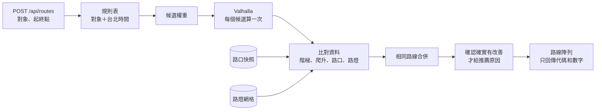

# 02 · 候選路線

後端依**使用者類型和時間**提供候選路線，推薦其中一條，並用一句話說明原因。

- **階段 1：** 只算標準步行，但回應格式已經是路線陣列。
- **階段 2：** 依下面的規則表加入候選。前端不用改合約。

## 情境規則表

規則放在單一設定檔 `api/app/route_rules.py`，隊友調整時只改這裡。

| 對象 | 時間 | 推薦候選 | 另一條候選 |
|---|---|---|---|
| 長者 | 白天 | `fewer_steps_hills` | `fastest` |
| 長者 | 晚上 | `fewer_steps_hills_bright` | `fastest` |
| 兒童 | 白天 | `fewer_unsignalized` | `fastest` |
| 兒童 | 晚上 | `fewer_unsignalized_bright` | `fastest` |
| 外籍人士 | 白天 | `fastest` | 無 |
| 外籍人士 | 晚上 | `bright` | `fastest` |

- **時間：** 由後端用台北時間判斷。晚上的起始定義是 18:00–06:00，放在設定檔。
- **Demo：** 白天要展示晚上，前端傳 `simulate: "night"`，畫面要標示「模擬晚上」。

## 算法



1. **權重：** 用下表的 Valhalla pedestrian costing。同一份路網，每次查詢可以換權重，不需要多份路網。
2. **比對：** 算每條路的階梯段數、爬升、路口種類、路燈比例。
3. **去重：** 兩條路的距離差不到 5%，而且 80% 以上的路線點距離對方不到 15 公尺，就算相同。
4. **原因：** **只有量得到改善才給原因代碼**。例如長者候選算出來的階梯數和最快路線相同，就不給 `fewer_steps`。
5. **繞路上限：** 多走超過 300 公尺，或超過最快路線的 1.5 倍，就推薦最快路線。起始值，放在設定檔。

### 候選權重（起始值）

| 候選 | 參數 |
|---|---|
| `fastest` | 預設值：`walkway_factor` 1.0、`sidewalk_factor` 1.0、`alley_factor` 2.0、`driveway_factor` 5.0、`use_hills` 0.5、`use_lit` 0 |
| 少階梯 | `step_penalty` 120、`elevator_penalty` 0 |
| 少坡 | `use_hills` 0.1（需要 `build_elevation`，效果待驗證） |
| 較亮 | `use_lit` 0.8，`alley_factor` 3 |
| 少過無燈路口 | `sidewalk_factor` 0.8、`walkway_factor` 0.9、`alley_factor` 3、`driveway_factor` 8，再加 `alternates: 2`，取無燈路口最少的一條 |

長者的所有候選都用 `walking_speed` 3.5 km/h 估時間，其他對象用預設 5.1 km/h。

候選名稱裡的權重直接相加，例如 `fewer_steps_hills_bright` 用少階梯＋少坡＋較亮。Valhalla 不能直接偏好有紅綠燈的路口，所以兒童候選要靠 `alternates` 加上比對結果來選。

## 資料

| 用途 | 來源 | 欄位 | 備註 |
|---|---|---|---|
| 站位 | TDX 公車 `StopOfRoute`、`Station`、`Route` | `StopUID`、`StopName`、`StopPosition`、`Bearing`、`StationID`、`StopBoarding` | 腳本產生快照，執行時不需要 TDX 金鑰 |
| 路網、階梯 | OpenStreetMap `taiwan-latest.osm.pbf`（328 MB） | `highway=steps` 約 6,271 段 | 裁切成臺北範圍再建圖 |
| 有紅綠燈的路口 | OpenStreetMap | `crossing=traffic_signals` 約 7,549 個 | |
| 沒有紅綠燈的路口 | OpenStreetMap | `crossing=uncontrolled`、`crossing=unmarked` 約 1,813 個 | |
| 其他路口 | OpenStreetMap | 其他 `highway=crossing` 約 7,428 個 | **算「不確定」** |
| 路燈 | [臺北市路燈位置分布圖](https://data.gov.tw/dataset/128270) | `TWD97X`、`TWD97Y`，148,135 筆，51 MB | TWD97 轉 WGS84，建置時轉成網格 |
| 道路照明標籤 | OpenStreetMap `lit` | 約 14,843 條 | Valhalla `use_lit` 使用 |
| 坡度 | Valhalla `build_elevation` | | 效果與映像大小待驗證 |

OSM 數字是 2026-11-07 用 Overpass 查的，範圍 lat 24.96–25.21、lon 121.45–121.67，也包含部分新北市（資料時間 2026-11-07T05:53Z）。

### 資料的限制

- OSM 中有 `sidewalk` 標籤的車道只有約 6%（1,275／20,435），所以**人行道資料不能用來宣稱安全**。
- [臺北市人行道](https://data.taipei/dataset/detail?id=3c834e59-1bd5-48ed-beaa-c72d13ada512)資料集只有統計數字，沒有位置，不能用於路徑。
- 行人事故點位目前沒有確認到可用資料，先不納入。
- OSM 標記不完整，有些地方兩條路會相同。要接受這個結果，並誠實顯示。

### 路燈比例怎麼算

把路線每 20 公尺取一點，附近 30 公尺內有路燈的比例，就是 `litRatio`。路燈網格是 `api/data/lamp_grid.json`（約 30 公尺一格）。門檻是起始值。**這是路燈密度，不是實際亮度**，文案要寫「路燈較多」。

## 用詞規則

**不能宣稱安全或無障礙。** 這是對弱勢使用者的承諾，資料又不完整，不能誇大。

| 不可以 | 要寫 |
|---|---|
| 安全路線 | 路燈較多的路 |
| 無障礙路線 | 少階梯、少坡的路 |
| 兒童安全路線 | 少過沒有紅綠燈路口的路 |

- 一定要說出依據，而且數字要來自 API。
- 沒有資料不代表沒有風險：沒有標示的路口算「不確定」，不能算成沒有風險。
- 開始走時一定要提醒：「請注意來車和紅綠燈。」
- 關於頁要列出資料來源與更新時間。

## 原因代碼與文案

API 只回代碼和數字，句子由前端的語言檔產生。

| 代碼 | 文案（zh-TW） | 需要的數字 |
|---|---|---|
| `fastest` | 這條路最快 | |
| `fewer_steps` | 少走 {n} 段階梯 | `diff.steps` |
| `flatter` | 少爬 {n} 公尺的坡 | `diff.climbM` |
| `brighter` | 路燈較多 | `metrics.litRatio` |
| `fewer_unsignalized_crossings` | 少過 {n} 個沒有紅綠燈的路口 | `diff.unsignalizedCrossings` |
| `extra_distance` | 多走 {n} 公尺 | `diff.distanceM` |

| `notes` 代碼 | 文案（zh-TW） |
|---|---|
| `no_better_route` | 這附近沒有找到更合適的路，帶你走最近的路 |
| `simulated_night` | 模擬晚上 |

組句範例：「多走 60 公尺，少走 1 段階梯。」上面的數字是文案範例。

## 畫面（P5）

```text
┌──────────────────────┐
│ 帶你走這條路         │
│ 380 公尺，約 7 分鐘  │
│                      │
│ 多走 60 公尺，       │
│ 少走 1 段階梯        │
│                      │
│     [ 開始走 ]       │
│     看其他路線       │  只有多條路時才顯示
└──────────────────────┘
```

卡片上的數字是版面範例。「看其他路線」只顯示距離、時間和原因，**不放地圖**。

## Demo 要求

- PM 和 API 要在會場附近找到**至少 2 組真實起終點**，推薦路線和最快路線確實不同，並到現場確認。
- 沒有明顯差別的情境，就不要拿來 Demo。
- 不可為了 Demo 捏造差別。

## 來不及時怎麼砍

依序移除，每一項都不影響主流程：

1. 坡度（`flatter`）：`build_elevation` 不順就拿掉，只留少階梯。
2. 兒童候選：`alternates` 比對最花時間。
3. 較亮候選。
4. 長者候選。全砍就回到階段 1。

## 來源

- [Valhalla Route API](https://valhalla.github.io/valhalla/api/route/api-reference/)
- [Valhalla Docker 說明](https://github.com/valhalla/valhalla/blob/master/docker/README.md)
- [TDX 運輸資料流通服務](https://tdx.transportdata.tw/)
- [臺北市路燈位置分布圖](https://data.gov.tw/dataset/128270)
- [Geofabrik Taiwan](https://download.geofabrik.de/asia/taiwan.html)
- OSM 計數：[Overpass API](https://overpass-api.de/)
