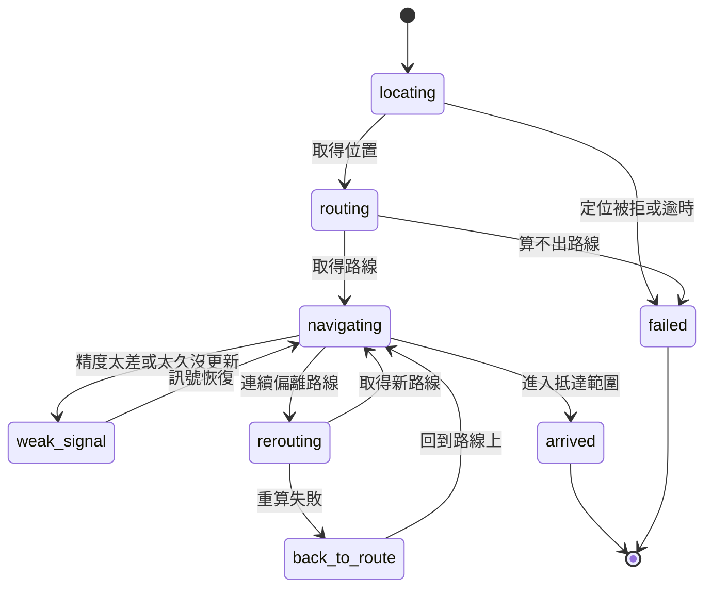

# 04 · 導航邏輯

導航邏輯在**網頁端**，放在 `web/src/nav/`，不依賴 Vue，可以用錄好的軌跡做自動測試。原因見 [ADR-0007](architecture/decisions/0007-keep-navigation-engine-in-web.md)。

## 模組

```text
web/src/
├─ sensors/
│  ├─ source.ts      SensorSource 介面（見 03）
│  ├─ web.ts         網頁羅盤與定位
│  ├─ handler.ts     備案，16:30 判斷後才做
│  ├─ replay.ts      模擬行走
│  └─ heading.ts     alpha/beta/gamma 轉成朝向
└─ nav/
   ├─ geo.ts         距離、方位角、投影到路線
   ├─ tracker.ts     目前在路線哪裡、下一個目標點
   ├─ arrow.ts       角度平滑、箭頭角度、方向文字
   ├─ machine.ts     導航狀態
   ├─ announcer.ts   何時說話與震動
   └─ config.ts      所有門檻參數
```

`nav/` 只吃資料、吐資料，不碰 DOM、不呼叫 API，也不直接呼叫 Handler。Vue 元件負責把狀態畫出來。

## 感測資料

### 朝向

```ts
// Android：deviceorientationabsolute；iOS：webkitCompassHeading
// 下面是 Android 的計算，手機上緣朝向
function headingFromOrientation(alpha: number, beta: number, gamma: number) {
  if (Math.abs(beta) < 60) return (360 - alpha) % 360   // 平放到斜拿：用手機上緣
  const a = rad(alpha), b = rad(beta), g = rad(gamma)   // 接近直立：用手機背面
  const x = -Math.cos(a) * Math.sin(g) - Math.sin(a) * Math.sin(b) * Math.cos(g)
  const y = -Math.sin(a) * Math.sin(g) + Math.cos(a) * Math.sin(b) * Math.cos(g)
  return (deg(Math.atan2(x, y)) + 360) % 360
}
```

- 這兩個來源都是**相對磁北**。臺北的磁偏角約 −4.7°，放在 `config.ts`，真北朝向 = 磁北朝向 + 磁偏角。要用羅盤實測確認。
- 手機畫面鎖直向，不處理橫向。
- 3 秒沒有朝向事件，就進入「沒有羅盤資料」畫面（[01](01-product-spec.md)）。距離、語音和抵達判斷繼續。

### 位置

```ts
navigator.geolocation.watchPosition(onPos, onErr, {
  enableHighAccuracy: true, maximumAge: 1000, timeout: 10000,
})
```

### 生命週期

- 按「開始走」才啟動，在這個點擊事件裡先呼叫 `requestPermission()`。
- 離開導航畫面、按結束、`pagehide` 時都要 `stop()`，並釋放 Wake Lock。
- 頁面從背景回來時（`visibilitychange`），要重新取得 Wake Lock。

## 狀態



每個狀態的畫面見 [01 導航畫面](01-product-spec.md#導航畫面)。P5 已取得路線時，直接從 `navigating` 開始。

**取得路線後就不需要網路。** 只有重新規劃才會呼叫 API。重算失敗時，用手上的路線把人帶回去。

**重算一律呼叫 `POST /api/routes`**，帶目前路線的 `id` 當 `candidate`。失敗就進 `back_to_route`，箭頭指最近的路線點。**正式流程不可以用 `straightRoute()` 或任何「直線連到終點」的路線**；`nav/synth.ts` 只給測試和實驗頁用。

**目的地一趟只定一次。** 重算時目的地沿用出發時那個站位，不可以用目前位置重新選「最近的站位」。公車站兩個方向的站位常在馬路兩側，重選會跳到對面，新路線要人過馬路，箭頭會往旁邊指（11/7 實測，見 `nav/destination.ts` 的 `createDestinationLock`）。

## 箭頭依路徑轉彎

箭頭指的是**路線上的下一段**，不是終點。路線是「先左轉再右轉」時：

```text
  終點 ●
       │ ③ 過了第二個轉角：箭頭指這段
  ┌────┘
  │ ② 過了第一個轉角：箭頭指這段，到第二個轉角前 30 公尺說「前面路口向右轉」
  │
  └──── ① 出發：箭頭指這段，到轉角前 30 公尺說「前面路口向左轉」
       ▲ 起點
```

1. **目標點**：從投影點沿路線往前 `lookaheadM`，但不超過下一個轉彎點。
2. **通過轉彎**：使用者離轉彎點 `turnPassM` 以內，或投影點的沿線距離已經超過轉彎點，這個轉彎**算已通過**，目標點改成下一段的前視點。通過後不會退回，也不會再提示同一個轉彎。
3. 這樣可以避免 GPS 已經過了轉角、投影還沒過時，目標點落在使用者背後，箭頭突然叫人向後轉。
4. **轉彎點**是 `maneuvers` 裡 `depart`、`straight`、`arrive` 以外的 `atIndex`。

> **17:10 已知問題（已修）：** 實測看起來箭頭一直指著終點。已用測試重現：tracker 在有轉彎的路線上本來就指第一段（箭頭 0°，終點方位 38.7°）；但 `NavLab.vue` 走偏重算時用 `straightRoute()` 直線連到終點，之後箭頭就等於終點方位（60.7° 對 58.7°）。另外銳角轉彎時 GPS 已過轉角、投影還在轉角前，會叫人「請向後轉」。修法：刪掉 `straightRoute()`，實驗頁合成路線重算一律走 `back_to_route`；tracker 加上 `turnPassM` 通過判斷。

## 每次更新的計算

```text
1. 找位置：把目前位置投影到路線，只往前找 100 公尺，避免跳回走過的路。
2. 找目標：從投影點沿路線往前 lookaheadM 公尺，但不能超過下一個「還沒通過」的轉彎點。
   離轉彎點 turnPassM 以內，或已經超過它，就把它標成已通過（見上一節）。
3. 算方位：
   bearing = atan2(sinΔλ·cosφ2, cosφ1·sinφ2 − sinφ1·cosφ2·cosΔλ)
4. 算箭頭：
   arrow = (bearing − heading + 360) % 360
5. 判斷：是否抵達、是否偏離、訊號是否太弱。
```

### 角度處理

朝向要用向量平均，避免 359° 和 1° 平均成 180°：

```ts
x = (1 - a) * x + a * Math.cos(rad)
y = (1 - a) * y + a * Math.sin(rad)
heading = Math.atan2(y, x)
```

CSS 旋轉要走最短方向，否則箭頭從 359° 到 1° 會轉一整圈：

```ts
const delta = ((target - current + 540) % 360) - 180
current += delta
```

`current` 可以超過 360，不要歸零。

### 朝向雜訊與重新定位

實測發現箭頭會突然亂抖，換頁回來後指針卡住不準。處理分三層（程式在 `nav/headingFilter.ts`、`nav/courseCheck.ts`、`nav/machine.ts`、`sensors/web.ts`）：

1. **濾波（headingFilter）**：平滑時間常數依「跟目前差多少」調整，穩定時用 `headingSlowTauMs`（壓抖動），正在轉用 `headingTauMs`（不拖尾）；單筆偏離超過 `headingSpikeDeg` 先當突波，連續 `headingSpikeConfirm` 筆一致才採用；輸出有 `headingDeadbandDeg` 死區；隔超過 `headingGapResetMs` 的第一筆直接採用。`alpha/beta/gamma` 轉朝向時，beta 在 50°–70° 之間用兩種算法混合，不再於 60° 硬切換。
2. **感測器自癒**：機器的 `tick()` 偵測「`headingStaleS` 秒沒有朝向事件」或「`headingFrozenS` 秒原始值完全沒變」，觸發 `onResync`，外部呼叫 `SensorSource.resync()`（拆掉重掛 `deviceorientation` 監聽與定位 watch）。有 `resyncCooldownS` 冷卻。頁面回到前景（`visibilitychange`、`pageshow`）或每秒計時器被凍結超過 3 秒（WebView 進背景不一定有事件）時，也會做一次。
3. **定期確認（courseCheck）**：用 GPS 走出去的方向對照這段時間的羅盤朝向。條件：精度好於 `courseMaxAccuracyM`、走超過 `max(courseMinMoveM, 1.5 × 精度)`、速度像走路、期間朝向沒大幅轉動。連續 `courseSamples` 次偏差一致且超過 `courseMismatchDeg`，`headingCheck` 變 `suspect`：自動重新接上感測器一次（`courseResyncCooldownS` 冷卻）並顯示「方向可能不準，請畫 8 字」；偏差都在 `courseOkDeg` 內變 `ok`。**假設使用者拿著手機朝前走**；模擬模式（位置是假的）關閉此檢查。
4. **手動**：導航畫面的「重新定位」按鈕，忘掉舊朝向、重接感測器、重新取得螢幕常亮。

### 方向文字

| 箭頭角度（左右對稱） | 指令 |
|---|---|
| 小於 25° | 往這走 |
| 25°–60° | 稍微向左／右 |
| 60°–150° | 向左／右轉 |
| 大於 150° | 請向後轉 |

下一個轉彎點在 `announceBeforeTurnM` 內時，改顯示「前面路口向左轉」。

## 參數

這些都是起始值，要用戶外實測調整，全部放在 `config.ts`。

| 參數 | 起始值 | 用途 |
|---|---|---|
| `lookaheadM` | 20 | 路線上的前視距離 |
| `turnPassM` | `max(8, 0.5 × accuracyM)` | 離轉彎點多近就算通過 |
| `headingTauMs` | 80 | 朝向平滑時間常數；係數 = 1 − e^(−dt/τ)，不受事件頻率影響（60 Hz 時約 0.2） |
| `headingSlowTauMs` | 350 | 朝向穩定時的時間常數（壓抖動） |
| `headingSlowBandDeg` | 25 | 差距小於此角度時，時間常數從快過渡到慢 |
| `headingSpikeDeg` / `headingSpikeConfirm` / `headingSpikeWindowMs` | 60 / 2 / 600 | 突波門檻、需連續確認幾筆、確認時間窗 |
| `headingGapResetMs` | 1500 | 隔這麼久沒資料，下一筆直接採用 |
| `headingDeadbandDeg` | 1.5 | 輸出死區 |
| `headingStaleS` / `headingFrozenS` / `resyncCooldownS` | 2 / 6 / 5 | 沒朝向事件、數值卡住多久自動重接感測器；重接最短間隔 |
| `courseMaxAccuracyM` / `courseMinMoveM` | 20 / 10 | 走向檢查的採樣條件（精度、移動距離） |
| `courseMinSpeedMps` / `courseMaxSpeedMps` | 0.8 / 3.5 | 走向檢查的速度範圍 |
| `courseSamples` / `courseMismatchDeg` / `courseOkDeg` / `courseSpreadDeg` | 3 / 45 / 25 / 30 | 走向檢查的判斷門檻 |
| `courseResyncCooldownS` | 60 | 走向檢查觸發重新定位的最短間隔 |
| `arrowTauMs` | 50 | 箭頭每一幀追目標角度的時間常數（取代 CSS transition） |
| `declinationDeg` | −4.7 | 磁偏角（待實測） |
| `arriveRadiusM` | `max(15, accuracyM)` | 抵達範圍 |
| `arriveHits` | 2 | 連續幾次才算抵達 |
| `offRouteM` | `max(30, 1.5 × accuracyM)` | 偏離距離 |
| `offRouteHits` | 3 | 連續幾次才算偏離 |
| `rerouteCooldownS` | 20 | 重新規劃的最短間隔 |
| `weakAccuracyM` | 50 | 精度差於此值算訊號弱 |
| `staleGpsS` | 15 | 超過此時間沒更新算訊號弱 |
| `headingLostS` | 3 | 超過此時間沒有朝向事件 |
| `announceBeforeTurnM` | 30 | 轉彎前多遠開始提示 |
| `repeatMuteS` | 10 | 同一句話的靜音時間 |

## 語音與震動

| 時機 | 語音（zh-TW） | 震動 |
|---|---|---|
| 開始走 | 請注意來車和紅綠燈 | |
| 接近轉彎 | 前面路口向左轉 | `turn` |
| 需要向後轉 | 請向後轉 | `warn` |
| 走偏 | 走偏了，正在重新找路 | `warn` |
| 抵達（公車站） | （導航不出聲；由 `/arrived` 畫面念「到了。等 307 號，往板橋方向」） | `arrive` |
| 抵達（一般地點） | （導航不出聲；實驗頁只顯示「到了」） | `arrive` |

規則：

- **抵達只震動、不出聲**：播報器的 `arrived` cue 是 `speak: false`。`/arrived` 畫面一打開就會念一次，導航再念會兩句疊在一起。
- 導航要記住使用者選的那班車：`Destination` 帶站點 API 的 `station` 和使用者選的 `stationRoute`（`destinationFromStation()`）。到站時 `router.push(arrivalFromStation(station, stationRoute, lang, audience))`，網址只有站名、路線名、方向，不帶座標和 UID。

- 句子來自語言檔，不用 LLM，也不用 Valhalla 的文字指令（它沒有 `zh-TW`）。
- 重要提示用 `interrupt: true` 打斷目前的語音。
- 同一句話在 `repeatMuteS` 內不重複。
- 語音開關只關語音，不關震動。
- `speak` 回 `no_voice` 時，這次使用不再要求語音，圖示改成靜音，畫面照常運作。

## 測試

用 Vitest 測試 `web/src/nav/`，資料放在 `web/src/nav/__fixtures__/`。

| 案例 | 預期 |
|---|---|
| 朝向 359° 和 1° 平滑 | 結果接近 0°，不是 180° |
| 箭頭從 350° 轉到 10° | 順時針轉 20° |
| 路線轉彎前 10 公尺（`turnPassM` 外） | 目標點是轉彎點，不會切過轉角 |
| L 形路線（先左轉再右轉），起點朝第一段 | 箭頭約 0°，指第一段，**不是**指向終點的方位 |
| 同一條路線，走到第一個轉角 `turnPassM` 內 | 目標點換到第二段；`nextTurn` 換成第二個轉彎 |
| GPS 已過轉角 10 公尺，但投影還在轉角前 | 轉彎算已通過，箭頭不會變成「請向後轉」 |
| 回放 L 形路線軌跡 | 每個轉彎各提示一次，順序是左、右；最後只抵達一次 |
| 重算失敗 | 進 `back_to_route`，箭頭指最近路線點；正式流程沒有任何地方呼叫 `straightRoute()` |
| GPS 跳到路線反方向 | 不會回到走過的路段 |
| 單次偏離 | 不會觸發重新規劃 |
| 連續 3 次偏離 | 只觸發一次重新規劃 |
| 重算失敗 | 進入 `back_to_route` |
| 精度 80 公尺 | 進入 `weak_signal` |
| 回放真實軌跡 | 最後進入 `arrived`，且只抵達一次 |
| 同一句話 3 秒內出現兩次 | 只說一次 |
