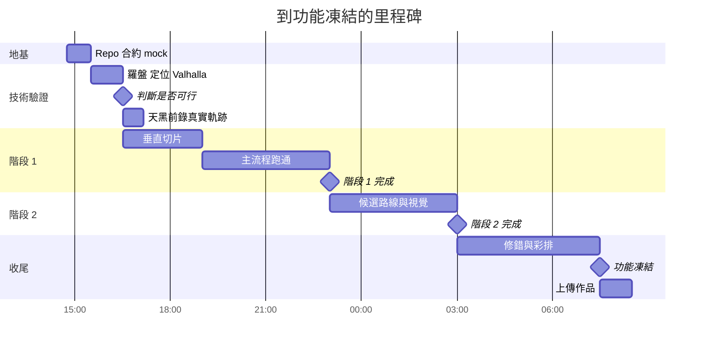
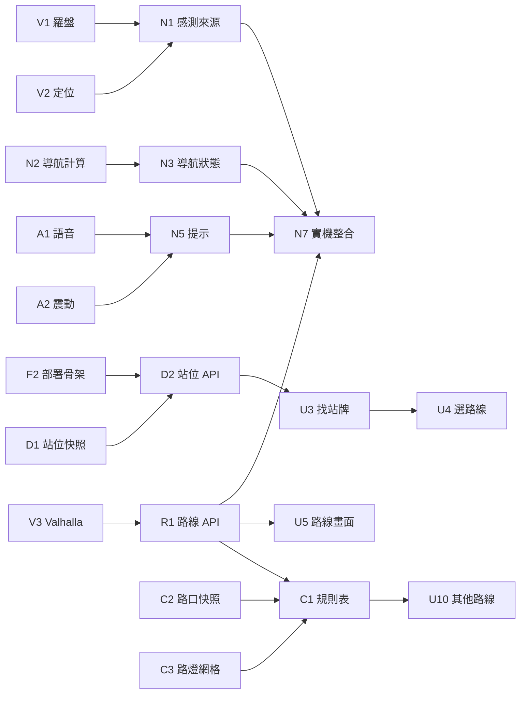

# 05 · Stories、分工與時程

階段 1 要在 **23:00 前**跑通，階段 2 在 **03:00 前**完成。

## 分工

| 代號 | 負責 | 需要的環境 | 隊員 |
|---|---|---|---|
| APP | App、Handler、APK | Flutter、Android 實機 | 隊長 |
| NAV | 前端 1：感測與導航 | Node | 待填 |
| UI | 前端 2：畫面、對象、語言 | Node，Figma | 待填 |
| API | 後端與資料：FastAPI、TDX 快照、Valhalla | Python，Valhalla 建置要 Docker | 待填 |
| PM | 規劃與 Demo：Repo、README、實測、彩排 | 會跑通主流程即可 | 待填 |

- 只有 4 人時，由 NAV 或 API 兼任 PM，戶外實測全組輪流。
- TDX 金鑰由隊長保管，只用來產生快照，不進 repo。
- 隊友要先加入 Firebase 專案才能部署預覽版。

## 時程

| 時間 | 必須達成 | 沒達成怎麼辦 |
|---|---|---|
| 15:30 | Repo、合約、mock 都就緒 | 先凍結合約，其他延後 |
| **16:30** | V1、V2、V3 都有結論 | 見下方「技術驗證」 |
| 17:10 前 | 錄一條真實走路軌跡（天黑前） | 改用路線合成的軌跡 |
| 19:00 | 假資料走完整個導航流程 | 砍掉階段 2 |
| **23:00** | 階段 1 用真實資料在實機跑通 | 只修錯，不開始階段 2 |
| 03:00 | 階段 2 完成 | 未完成的情境直接移除（[02](02-route-candidates.md#來不及時怎麼砍)） |
| **07:30** | 功能凍結 | 只修錯、補 README、彩排 |
| **08:30** | 作品上傳（截止 09:00） | |

## 技術驗證：16:30 判斷

| ID | 負責 | 要驗證什麼 | 通過標準 | 沒通過 |
|---|---|---|---|---|
| V1 | NAV＋APP | 實體 Android 手機、TownPass WebView 內的 `deviceorientationabsolute` | 有事件；對照指南針 App 誤差不超過 15° | APP 做 `nav_sensors` 的朝向 |
| V2 | NAV＋APP | 同環境的 `watchPosition` | 戶外持續更新；精度合理 | APP 做 `nav_sensors` 的位置 |
| V3 | API | 用臺北裁切資料建 Valhalla，部署到 Cloud Run | 能回傳步行路線；記錄映像大小、記憶體、冷啟動 | 改 OSRM（`foot.lua`）；階段 2 只留可行的情境 |

- 把測試頁部署到 Hosting 預覽版，用測試服務開啟，不需要等完整畫面。
- 模擬器沒有真實羅盤，V1 要用實體手機。
- **iOS 無法驗證**，因為手邊沒有 Mac。文件和發表都要標「待驗證」，不能說已支援。

## 依賴關係

有 mock 時，前端不需要等後端。

## 階段 1 Stories

### 地基

| ID | 負責 | 故事 | 驗收條件 |
|---|---|---|---|
| F1 | PM | 作為隊員，我要有共用的 repo | 用 EricChan0519/2026CodeFest；全英文路徑；含 `app/ web/ api/ routing/ scripts/ docs/`；LICENSE 有 AGPL-3.0 與主辦聲明；全員能 clone；上傳前改成公開 |
| F2 | API | 作為前端，我要能呼叫部署好的 API | `web` 上 Hosting；`api` 上 Cloud Run；`/api/health` 經 rewrite 回 200；有 Dockerfile |
| F3 | APP | 作為使用者，我要在城市通看到這個服務 | 服務已預設置頂；`destinationUrl` 是 HTTPS；main manifest 有 `INTERNET`；release APK 能打開網頁 |
| F4 | API | 作為前端，我不想等後端 | 15:30 前 [03](03-contracts.md) 的 mock 都有；`VITE_API_MOCK=1` 可切換 |

### App

| ID | 負責 | 故事 | 驗收條件 |
|---|---|---|---|
| A1 | APP | 作為看不清楚螢幕的人，我要聽得到提示 | `speak` 符合合約；能切語言和語速；可以打斷；沒有語音包時回 `no_voice`，不會閃退；列出 Demo 手機有哪些語言 |
| A2 | APP | 作為走路的人，我要感覺得到提示 | `haptic` 三種提示可分辨；在實機測過 |
| A3 | APP | 作為隊伍，我們要有穩定的 APK | 感測備案（V1、V2 需要時）符合合約；新 Handler 檢查來源；重複 `start` 不增加訂閱；當天不重新 build 未驗證的版本 |

### 站牌資料

| ID | 負責 | 故事 | 驗收條件 |
|---|---|---|---|
| D1 | API | 作為系統，我要有站位快照 | `scripts/build_stop_index.py` 從 TDX 產生 `api/data/stop_index.json`；排除只能下車的站；同名不同站位分開；包含中文和英文；印出有英文站名的比例；服務執行時不需要 TDX |
| D2 | API | 作為前端，我要查附近和搜尋站位 | 兩個 API 符合合約；回應少於 1 秒；座標不進 log |

### 路線

| ID | 負責 | 故事 | 驗收條件 |
|---|---|---|---|
| R1 | API | 作為前端，我要拿到統一格式的路線 | `POST /api/routes` 符合合約，`metrics` 是 `null`；Valhalla 格式只出現在 adapter；polyline 解成 `[lat, lon]`；設定 `--max-instances`；座標不進 log |
| R2 | API | 作為隊伍，上台前要能確認服務正常 | `/api/health?deep=1` 會檢查路徑服務和快照 |

### 導航

| ID | 負責 | 故事 | 驗收條件 |
|---|---|---|---|
| N1 | NAV | 作為開發者，我要能在瀏覽器開發 | 依 16:30 的結論實作感測來源；瀏覽器不需要手機就能跑 |
| N2 | NAV | 作為走路的人，箭頭要指向路線，不能穿過馬路 | [04](04-nav-logic.md) 的計算案例都有單元測試並通過 |
| N3 | NAV | 作為走路的人，系統要知道我走到哪裡 | 狀態圖全部實作；所有狀態都有對應畫面 |
| N4 | NAV | 作為走偏的人，我要被帶回路上 | 連續偏離才重算；有冷卻時間；重算失敗時指回路線；沿用目前的候選 id |
| N5 | NAV | 作為走路的人，我要在轉彎和抵達時收到提示 | 轉彎、走偏、抵達都有語音和震動；不會重複；語音失敗不影響導航；長者語速較慢 |
| N6 | NAV | 作為評審，我要能在室內看到完整流程 | `?demo=1` 不連網可跑完；標示「模擬」；朝向仍是真實羅盤；可以重來；先開過一次後，飛航模式也能打開頁面（`vite-plugin-pwa` 預先快取，WebView 內待驗證） |
| N7 | NAV | 作為使用者，我要在實機走完全程 | 實機戶外走完；抵達時離站牌不超過 30 公尺；連續成功 3 次；螢幕不會自動關閉 |

### 畫面

| ID | 負責 | 故事 | 驗收條件 |
|---|---|---|---|
| U1 | UI | 作為使用者，畫面要像城市通的一部分，也要看得清楚 | 用 UI Kit 色票建 tokens 和共用元件；符合易讀規則；375px 不破版 |
| U2 | UI | 作為第一次使用的人，我要先選誰在用和語言 | 選擇存 localStorage；之後跳過；設定頁可改；`audience.ts` 是唯一的對象設定 |
| U3 | UI | 作為使用者，我要快速找到站牌 | 附近清單是首頁；定位失敗時引導搜尋；有載入、空資料、錯誤畫面 |
| U4 | UI | 作為使用者，我要找到正確方向的站牌 | 同名站位分開列；顯示路線、往哪裡、距離、行進方向 |
| U5 | UI | 作為使用者，我要知道要走多遠 | 顯示距離和時間；「開始走」；階段 1 只有一條路時不顯示「看其他路線」 |
| U6 | UI | 作為走路的人，我看一眼就知道往哪走 | 符合 [導航畫面規格](01-product-spec.md#導航畫面)；全部狀態都有；箭頭順暢、不會多轉一圈；只有兩顆按鈕；低階手機也順 |
| U7 | UI | 作為抵達的人，我要確定這裡是對的站牌 | 打勾、站名、路線、方向、「完成」 |
| U8 | UI | 作為外籍人士，我要能用自己的語言 | 8 種語言的語言檔齊全；全站沒有寫死的文字；站名規則正確；每種語言在 375px 都截圖檢查過；Demo 手機上字都顯示得出來 |
| U9 | UI | 作為評審，我想知道資料和技術來源 | 關於頁有理念、對象、資料連結與時間、架構圖、套件授權、翻譯確認狀態 |

### 實測

| ID | 負責 | 故事 | 驗收條件 |
|---|---|---|---|
| T1 | PM | 作為隊伍，我們要確認實際可行 | 戶外實測 3 條路線，記錄抵達誤差和羅盤誤差；17:10 前至少錄一條軌跡做成 Demo 資料 |

## 階段 2 Stories

| ID | 負責 | 故事 | 驗收條件 |
|---|---|---|---|
| C1 | API | 作為使用者，我要拿到適合我的路線 | `route_rules.py` 實作規則表；權重組合正確；去重；繞路上限；只有量得到改善才給原因；`no_better_route` 正確 |
| C2 | API | 作為兒童，我想少過沒有紅綠燈的路口 | `scripts/build_crossings.py` 從 OSM 產生快照；分清楚有燈、無燈、不確定；`metrics` 正確 |
| C3 | API | 作為晚上走路的人，我想走路燈較多的路 | `scripts/build_lamp_grid.py` 從路燈資料建網格；TWD97 轉 WGS84 正確；`litRatio` 正確；服務啟動不載入原始檔 |
| C4 | API | 作為長者，我想少階梯少坡 | 階梯用 `step_penalty`；`build_elevation` 可行才做坡度；不可行時 `climbM` 是 `null`，不給 `flatter` |
| C5 | API | 作為評審，我想在白天看到晚上的效果 | `simulate: "night"` 可用；回應有 `simulated_night` |
| C6 | PM | 作為評審，我要看到真實的路線差別 | 找到至少 2 組起終點，推薦路線和最快路線確實不同；到現場確認；內建成 Demo 路線 |
| U10 | UI | 作為使用者，我想知道為什麼推薦這條路 | P5 依代碼和數字組句，8 種語言都有；「看其他路線」可切換；全站不出現「安全」「無障礙」 |
| U11 | UI | 作為評審，我要知道現在是模擬晚上 | 設定頁或 Demo 模式有開關；畫面標示「模擬晚上」 |

## 交付

| ID | 負責 | 故事 | 驗收條件 |
|---|---|---|---|
| Z1 | PM | 作為評審，我要能照著 README 建置 | 含架構圖、資料清單與更新頻率、套件授權、AI 揭露、Docker 步驟、App 改動清單、模擬資料標示 |
| Z2 | PM | 作為資訊局，我要能接手 | Dockerfile、`.env.example`、資料更新腳本、維運說明都完成 |
| Z3 | UI | 作為外籍使用者，翻譯要能相信 | 每種語言標示誰確認過；沒人能確認的語言在關於頁寫明 |
| Z4 | PM | 作為發表者，我要能準時講完 | [06](06-demo-script.md) 初選和決選各彩排 3 次；飛航與斷網備援都測過；HDMI 鏡像試過 |
| Z5 | PM | 作為隊伍，我們要準時繳交 | 08:30 前上傳；repo 公開；LICENSE 正確 |

## 可以順手做，不算範圍內

| ID | 內容 | 條件 |
|---|---|---|
| I1 | iOS 實機驗證，補 `Info.plist` 的用途說明 | 有 Mac 的隊友，其他都完成才做 |
| I2 | `routing` 服務改成 IAM 保護，`api` 用 ID token 呼叫 | 階段 2 完成後 |

## 完成的定義

一個 Story 要同時符合：

1. 驗收條件全部通過。
2. 程式已合併，並部署到預覽版或正式版。
3. 負責人讀過並能解釋 AI 產生的程式碼。
4. 用到的套件和資料已寫進 README。
5. 需要實機的項目，已經在實機測過。

進度請更新在共編文件的追蹤表。
