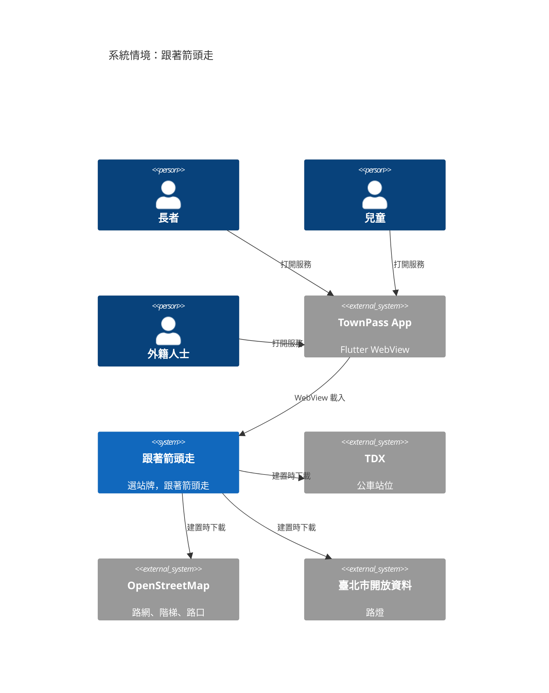
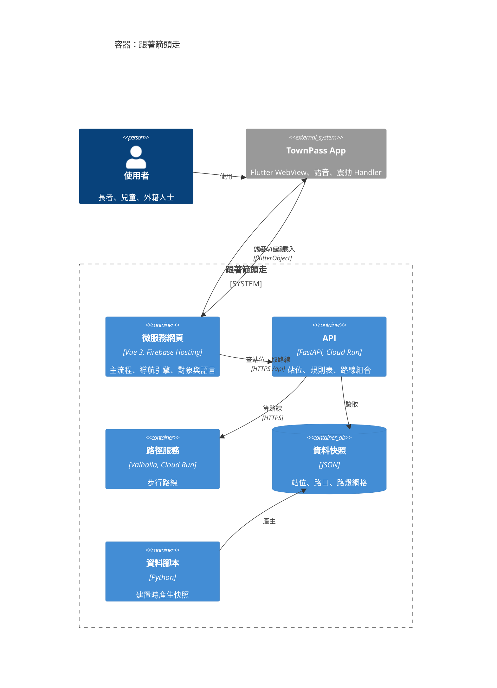
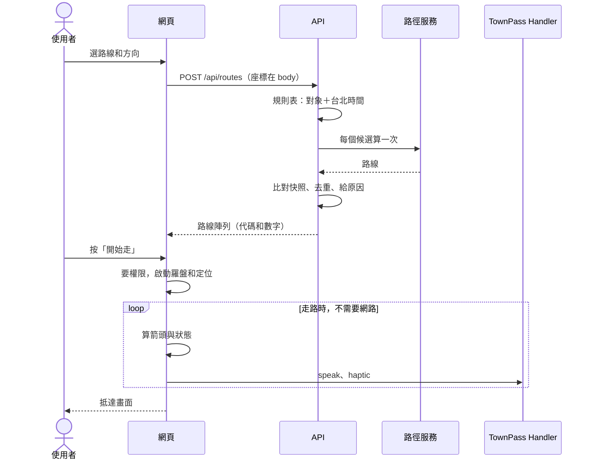
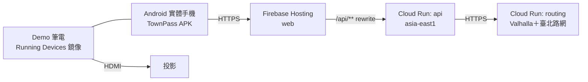

# arc42 架構文件：跟著箭頭走

本文件用 arc42 精簡版（ESSENTIAL）記錄架構，圖用 C4 Context 和 Container。模型來源是 [workspace.dsl](workspace.dsl)。

這是單一系統，所以不用 ArchiMate 和 TOGAF：那兩者處理的是跨系統的企業架構和治理流程，這裡用不到。

## 1. 簡介與目標

把地圖換成一支箭頭，讓長者、兒童、外籍人士能走到正確方向的公車站牌。產品規格見 [01](../01-product-spec.md)。

| 優先 | 品質目標 | 量測方式 |
|---|---|---|
| 1 | 易懂 | 導航畫面只有站名、箭頭、距離、一句話、兩顆按鈕；第一次使用不超過 6 步 |
| 2 | Demo 不中斷 | 取得路線後斷網仍可走完；主流程連續 3 次成功 |
| 3 | 指向正確 | 羅盤誤差不超過 15°；抵達提示時離站牌不超過 30 公尺 |
| 4 | 誠實 | 全站不宣稱安全或無障礙；每個推薦原因都有量測數字 |
| 5 | 可移交 | 資訊局照 README 可重建；無資料庫；全部開源 |

| 關係人 | 關心什麼 |
|---|---|
| 使用者 | 看得懂、走得到 |
| 評審 | 服務應用、視覺、技術穩定、能否落地 |
| 臺北市資訊局 | 可整併、可維運、授權乾淨 |
| 隊友 | 能平行開發、能加技術 |

## 2. 限制

| 限制 | 來源 |
|---|---|
| AGPL-3.0，只用開源免費套件 | 比賽規則 |
| 不用 Google Maps、Mapbox | 比賽規則 |
| 執行時 AI 只能在裝置端 | 比賽規則 |
| 核心資料是開放資料，註明出處 | 比賽規則 |
| 部署用免費方案，後端附 Dockerfile | 比賽規則 |
| 只有隊長有 Flutter 環境 | 隊伍 |
| 手邊沒有 Mac，iOS 無法驗證 | 隊伍 |
| 11/8 07:30 功能凍結 | 比賽時程 |

## 3. 情境與範圍



**執行時不依賴任何外部資料服務。** TDX 金鑰只用在建置腳本。

| 外部介面 | 方向 | 格式 |
|---|---|---|
| TownPass Bridge | 雙向 | `flutterObject`，見 [03](../03-contracts.md) |
| TDX | 建置時下載 | REST JSON，要金鑰 |
| OSM | 建置時下載 | PBF、Overpass |
| 臺北市路燈 | 建置時下載 | JSON，TWD97 |

## 4. 解決方案策略

| 目標 | 做法 |
|---|---|
| 易懂 | 對象是設定，不是三套畫面；導航畫面極簡 |
| Demo 不中斷 | 導航在網頁端算；路線取得後離線；資料用快照；內建 Demo 路線 |
| 指向正確 | 感測來源可替換；16:30 實機判斷；回放測試 |
| 誠實 | 原因必須量得到；用詞政策 |
| 可移交 | 薄 App；無資料庫；路徑引擎隔離在 adapter |

## 5. 建構區塊



| EA ID | 元件 | 職責 | 負責 |
|---|---|---|---|
| ea:townpass:arrow-nav:system:arrow-nav | 系統 | 整個服務 | 全組 |
| ea:townpass:arrow-nav:external:townpass-app | TownPass App | WebView、Handler | APP |
| ea:townpass:arrow-nav:container:web | 微服務網頁 | 畫面、導航引擎 | NAV、UI |
| ea:townpass:arrow-nav:container:api | API | 站位、規則表、組合路線 | API |
| ea:townpass:arrow-nav:container:routing | 路徑服務 | Valhalla | API |
| ea:townpass:arrow-nav:container:snapshots | 資料快照 | 站位、路口、路燈網格 | API |
| ea:townpass:arrow-nav:container:scripts | 資料腳本 | 產生快照 | API |

### Repo 結構

```text
app/        TownPass fork（只有隊長改）
web/        Vue 微服務
  src/sensors/    感測來源
  src/nav/        導航引擎，純函式
  src/i18n/       8 種語言
  src/audience.ts 對象設定
  public/demo/    內建 Demo 路線
api/        FastAPI
  app/adapters/   Valhalla 等外部格式只出現在這裡
  app/route_rules.py  規則表
  data/           快照
routing/    Valhalla Dockerfile 與建圖設定
scripts/    快照腳本
docs/       本文件
```

## 6. 執行情境

### 取得路線並導航



### 走偏

連續 3 次偏離才重算，只算目前候選。重算失敗時進入 `back_to_route`，用手上的路線把人帶回去。

## 7. 部署



| 項目 | 值 |
|---|---|
| GCP 專案 | `townpass-hackathon-2026` |
| Hosting | `https://townpass-hackathon-2026.web.app` |
| `api` | 既有 Cloud Run 服務；`--max-instances` 限制用量 |
| `routing` | 新增 Cloud Run 服務；路網打包進映像；記憶體依 V3 實測 |
| 快照更新 | 手動跑腳本，重新部署 `api` |
| 冷啟動 | 不設最小實例（免費）；上台前打 `/api/health?deep=1` 暖機 |

## 8. 橫切規則

| 主題 | 規則 |
|---|---|
| 位置隱私 | 座標放 POST body，不放網址，不進 log；[ADR-0005](decisions/0005-keep-location-out-of-urls-and-logs.md) |
| 個資 | 不用帳號，不讀 `userinfo`；外部資料只留白名單欄位 |
| 多語 | 句子只在前端語言檔；API 只回代碼和數字；預先翻譯 |
| 對象 | 只有 `audience.ts` 和 `route_rules.py`，不做分支畫面 |
| 用詞 | 不宣稱安全或無障礙；[ADR-0006](decisions/0006-recommend-routes-with-measured-reasons.md) |
| 座標 | WGS84、`lat`/`lon`；TWD97 只出現在腳本 |
| 外部格式 | 只出現在 `api/app/adapters/` 和 `scripts/` |
| 錯誤 | API 回代碼；前端每個狀態都有畫面；Handler 失敗不中斷導航 |
| Handler 安全 | 新 Handler 檢查 `sourceOrigin` |
| 機密 | TDX 金鑰不進 repo，不進執行環境 |

## 9. 架構決策

| ADR | 決策 | 狀態 |
|---|---|---|
| [0001](decisions/0001-keep-the-app-thin.md) | App 保持很薄，功能放網頁 | accepted |
| [0002](decisions/0002-use-valhalla-for-walking-routes.md) | 用 Valhalla 算步行路線，OSRM 備案 | proposed |
| [0003](decisions/0003-use-web-sensors-first.md) | 感測先用網頁能力，備案是 Flutter 跨平台 Handler | accepted |
| [0004](decisions/0004-serve-open-data-from-snapshots.md) | 開放資料用快照提供 | accepted |
| [0005](decisions/0005-keep-location-out-of-urls-and-logs.md) | 位置不進網址和 log | accepted |
| [0006](decisions/0006-recommend-routes-with-measured-reasons.md) | 用規則表推薦路線，原因必須量得到 | accepted |
| [0007](decisions/0007-keep-navigation-engine-in-web.md) | 導航引擎放在網頁 | accepted |

## 10. 品質情境

| ID | 情境 | 反應 | 量測 |
|---|---|---|---|
| Q1 | 使用者第一次打開服務 | 走完 6 步開始導航 | 不超過 6 步，熟悉 Demo 的人 60 秒內完成 |
| Q2 | 轉動手機 | 箭頭跟著轉 | 視覺延遲低於 200 ms；誤差不超過 15° |
| Q3 | 走到站牌 | 出現抵達畫面 | 離站牌不超過 30 公尺，只抵達一次 |
| Q4 | 導航中斷網 | 繼續導航，走偏時帶回路線 | 飛航模式走完 Demo 路線 |
| Q5 | 評審關網路 | `?demo=1` 跑完 | 頁面已開啟或已快取時，全程沒有錯誤畫面 |
| Q6 | API 冷啟動 | 暖機後正常回應 | 暖機後 `/api/routes` 低於 3 s |
| Q7 | 手機沒有該語言語音 | 改用文字和震動 | 不閃退，主流程可完成 |
| Q8 | 候選路線沒有改善 | 誠實說明 | 回應有 `no_better_route`，且 `reasons` 沒有捏造 |
| Q9 | 檢查請求紀錄 | 找不到座標 | 網址和應用 log 都沒有 `lat`、`lon` 數值 |
| Q10 | 隊友新增候選 | 只改規則和語言檔 | 不改合約，不改 `web/src/nav/` |

## 11. 風險與技術債

| 風險 | 影響 | 對策 | 判斷時間 |
|---|---|---|---|
| WebView 內羅盤事件不可用或不準 | 核心功能失效 | `nav_sensors` 備案 | 16:30 |
| 場館鋼構干擾羅盤 | Demo 箭頭亂轉 | 開場前校正、遠離金屬、滑桿備案 | 彩排 |
| iOS 未驗證 | 不能宣稱雙平台 | 標「待驗證」；有 Mac 才做 I1 | 持續 |
| Valhalla 映像超過 Artifact Registry 免費 0.5 GB | 可能產生少量費用 | V3 記錄大小；隊長決定；賽後清除；不行就改 OSRM 或縮小路網 | 16:30 |
| `build_elevation` 增加映像大小或效果不明 | 「少坡」做不出來 | 拿掉 `flatter`，只留少階梯 | 階段 2 |
| OSM 標記不完整 | 候選常常相同 | 誠實顯示；Demo 前實地找路線 | 階段 2 |
| 翻譯沒有母語者確認 | 給出錯誤指示 | 標示確認狀態；句型保持簡短 | 交付前 |
| 手機缺語音包或字型 | 部分語言沒語音或亂碼 | 文字＋震動；內嵌字型 | 19:00 |
| 同一個 `onReply` 不能重複呼叫（只影響備案） | 備案 Handler 不能串流 | 改成輪詢，介面不變 | 16:30 |
| 手機直向以外的拿法 | 箭頭誤差 | 鎖直向；平放到直立都要測 | 實測 |

**接受的技術債：** 快照手動更新；沒有自動化監控；`routing` 服務先公開，只靠 `--max-instances` 限制用量（I2 可補）。

## 12. 名詞

| 名詞 | 意思 |
|---|---|
| 站位 | 特定方向的實體站牌。同名站可能有多個站位 |
| 對象 | 長者、兒童、外籍人士，是設定，不是帳號 |
| 候選路線 | 依對象和時間算出的路線，可能有多條 |
| 推薦原因 | 量得到的改善，例如少走 1 段階梯 |
| 快照 | 建置時從開放資料產生的檔案 |
| 模擬行走 | `?demo=1`，位置是模擬的，朝向是真實羅盤 |
| Handler | App 提供給網頁的原生能力 |
