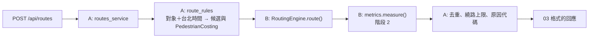

# API 兩人分工設計

日期：2026-11-07。依據：[05 Stories](../../arrow-nav/05-stories.md)、[03 合約](../../arrow-nav/03-contracts.md)、[02 候選路線](../../arrow-nav/02-route-candidates.md)、[計畫](../plans/2026-11-07-arrow-nav.md) 的 API1–API9。

05 的 API 角色由兩人負責。這份文件定義兩人各做什麼、共用哪個介面、怎麼各自測試再整合。**對外合約仍以 03 為準**，這裡只補兩人之間的內部介面。

## 1. 範圍與硬性規則

- **地圖：** 畫面依 01 不放地圖。後端只用 OpenStreetMap＋Valhalla（備案 OSRM）。**禁止** Google Maps、Google Directions／Geocoding／Places、Mapbox 的任何 API 或 SDK。
- 之後若要加地圖，只能用 Leaflet＋國土測繪中心圖磚（路徑 `{z}/{y}/{x}`，y 在前），並在關於頁註明出處。
- 外部資料的格式（TDX、Valhalla、OSRM、Overpass、路燈原始檔）只能出現在 `api/app/adapters/` 和 `scripts/`。
- 使用者座標只放 POST body，不進網址、不進 log、不出現在錯誤回應（ADR-0005）。
- TDX 金鑰由隊長保管，只在本機產生快照時用環境變數帶入，不進 repo。
- 新套件只用 MIT／BSD／Apache-2.0，並登記到 README。

## 2. 分工

**分界是路徑引擎 adapter。** B 把 Valhalla（或 OSRM）的回應轉成第 3 節的 `EngineRoute`，A 只用 `EngineRoute` 組 03 的回應。V3 失敗改 OSRM 時，只有 B 要改。

| | A：服務與站位 | B：路徑與地理資料 |
|---|---|---|
| 隊員 | Daniel（s6663296） | 待填 |
| 負責的檔案 | `api/app/main.py`、`errors.py`、`schemas.py`、`engine.py`（草擬，兩人共同凍結）、`stations.py`、`routes_service.py`、`route_rules.py`、`adapters/fake.py`；`api/Dockerfile`、`api/.env.example`、`api/tests/`（除 B 的檔案外）；`scripts/tdx.py`、`scripts/build_stop_index.py`；`api/data/stop_index.json`；`web/src/mocks/*.json` | `routing/`；`api/app/adapters/valhalla.py`、`adapters/osrm.py`（備案）、`metrics.py`；`api/tests/test_valhalla.py`、`test_metrics.py`、`api/tests/fixtures/valhalla_*.json`；`scripts/build_crossings.py`、`build_lamp_grid.py`；`api/data/crossings.json`、`lamp_grid.json`；`docs/arrow-nav/verification.md` 的 V3 段落 |
| 階段 1 Stories | F4（15:30）、F2 的程式部分、D1、D2、R1 的 endpoint、R2 | V3（16:30）、R1 的 adapter |
| 階段 2 Stories | C1、C5；協助 PM 做 C6 | C2、C3、C4 |
| 對應計畫任務 | API1、API3、API4、API5 的 endpoint 部分、API8 的規則部分 | API2、API5 的 adapter 部分、API6、API7、API8 的 metrics 部分、API9 |
| 不用等對方 | 用 `FakeEngine` 回固定路線，endpoint 照常開發與測試 | 用 fixture 與腳本直接測 adapter 和 metrics，不需要 FastAPI |

- 兩人的檔案不重疊。要改對方的檔案，先講。
- **部署：** `api` 由隊長用 gcloud 部署（A 這台沒有 gcloud）；A 負責 Dockerfile，並在本機 `docker run` 測過。`routing` 由 B 部署；B 也沒有 gcloud 時同樣交給隊長。
- 舊程式 61d5560（骨架、錯誤格式、mock）與 cddc138（nearby／search）已被 revert，可以參考或複製，但必須通過本文件的測試。

## 3. 共用內部介面：`api/app/engine.py`

**和 03 合約一起在 15:30 凍結。** A 先草擬並放進第一個 PR；兩人都同意才能改。

```python
from dataclasses import dataclass
from typing import Literal, Protocol

LatLon = tuple[float, float]                # (lat, lon)，WGS84

ManeuverKind = Literal["depart", "straight", "slight_left", "slight_right",
                       "left", "right", "uturn", "stairs", "arrive"]

@dataclass(frozen=True)
class PedestrianCosting:                    # 欄位名稱沿用 02 的權重表
    walkway_factor: float = 1.0
    sidewalk_factor: float = 1.0
    alley_factor: float = 2.0
    driveway_factor: float = 5.0
    use_hills: float = 0.5
    use_lit: float = 0.0
    step_penalty: float | None = None       # None：用引擎預設
    elevator_penalty: float | None = None
    walking_speed_kmh: float = 5.1          # 長者 3.5

@dataclass(frozen=True)
class Maneuver:
    kind: ManeuverKind
    at_index: int                           # geometry 的索引
    distance_to_next_m: float
    street: str | None

@dataclass(frozen=True)
class EngineRoute:
    distance_m: float
    duration_s: float
    geometry: list[LatLon]                  # 已解碼，不是 polyline 字串
    maneuvers: list[Maneuver]

class RouteNotFound(Exception): ...         # A 轉成 404 ROUTE_NOT_FOUND
class RoutingUnavailable(Exception): ...    # A 轉成 503 ROUTING_UNAVAILABLE

class RoutingEngine(Protocol):
    async def route(self, origin: LatLon, dest: LatLon,
                    costing: PedestrianCosting, alternates: int = 0) -> list[EngineRoute]:
        """第一筆是主路線，之後是 alternates。至少回一筆，否則丟 RouteNotFound。
        alternates 只是上限：Valhalla 可能回得比要求少（短路線常只有主路線），呼叫端不可假設筆數。"""
    async def ping(self) -> bool:
        """/api/health?deep=1 使用。不丟例外，失敗回 False。"""

def get_engine() -> RoutingEngine:
    """依 ROUTING_ENGINE 回傳實作：fake（A 寫）、valhalla、osrm（B 寫）。"""
```

### 階段 2 增加：`api/app/metrics.py`（B 實作，介面同時凍結）

```python
@dataclass(frozen=True)
class Metrics:                              # 欄位對應 03 的 routes[].metrics
    steps: int | None
    climb_m: float | None                   # 沒有坡度資料時是 None
    lit_ratio: float | None
    unsignalized_crossings: int | None
    signal_crossings: int | None
    unknown_crossings: int | None

def measure(route: EngineRoute) -> Metrics:
    """讀 crossings.json、lamp_grid.json（啟動時載入一次）。快照不存在時對應欄位回 None，不丟例外。"""
```

- B 交付 `measure` 之前，A 用 stub（全部 `None`）開發。
- A 只用 `Metrics` 的數字決定推薦和原因，不讀快照原始檔。
- 坡度要另外呼叫 Valhalla `/height` 時，由 B 在 adapter 內處理，`measure` 介面不變。

### 環境變數

| 變數 | 值 | 誰用 |
|---|---|---|
| `ROUTING_ENGINE` | `fake`（預設，本機與測試）、`valhalla`、`osrm` | A 的 `get_engine` |
| `ROUTING_URL` | `routing` 服務網址 | B 的 adapter |
| `ROUTING_TIMEOUT_S` | 預設 8 | B 的 adapter；逾時丟 `RoutingUnavailable` |
| `ROUTING_AUTH` | `none`（預設）、`iam`（routing 是私有服務，用 ID token 呼叫） | B 的 adapter |
| `APP_VERSION` | commit 短碼，沒有時用 `K_REVISION` | A 的 `/api/health` |

## 4. `POST /api/routes` 的資料流



- **階段 1：** 只算 `fastest`；`metrics`、`diff` 都是 `null`；`reasons` 是 `["fastest"]`。
- **階段 2：** 規則表、去重門檻、繞路上限、原因判斷都依 02，數值放在 `route_rules.py`。兒童候選用 `alternates=2`，A 依 `measure()` 的 `unsignalized_crossings` 取最少的一條。Valhalla 不一定回替代路線（實測短路線要 2 條只回主路線），A 必須能只用回來的筆數挑選；只有一條時就用它，再走一般的去重與 `no_better_route` 判斷。
- `candidate` 有值時只算那一條；`simulate: "night"` 時 `period` 是 `night`，`notes` 加上 `simulated_night`。
- `to.stationUid` 不參與路徑計算，只用座標算路。

### 部署（`api`）

```bash
gcloud run deploy api --source api --region asia-east1 --allow-unauthenticated --max-instances 2 \n  --set-env-vars ROUTING_ENGINE=valhalla,ROUTING_URL=https://routing-239765207532.asia-east1.run.app,ROUTING_AUTH=iam
```

`routing` 不開放公開呼叫；`api` 的服務帳號要有 `routing` 的 `roles/run.invoker`。

## 5. 錯誤與隱私

| 狀況 | 誰丟 | 回應 |
|---|---|---|
| 請求格式錯誤 | FastAPI 驗證 | 422 `VALIDATION_ERROR`，**不回傳輸入內容** |
| 起點或終點不在服務範圍（lat 24.96–25.21、lon 121.45–121.67） | A | 400 `OUT_OF_AREA` |
| 走不到 | B 丟 `RouteNotFound` | 404 `ROUTE_NOT_FOUND` |
| 引擎掛掉、逾時、5xx | B 丟 `RoutingUnavailable` | 503 `ROUTING_UNAVAILABLE` |
| 站位快照讀不到 | A | 503 `DATA_UNAVAILABLE`；`/api/health` 的 `stopIndexUpdatedAt` 是 `null` |

- B 的 adapter 不可以 log 請求內容或座標。A 用 caplog 測試在 nearby 與 routes 都沒有座標進 log。

## 6. 測試

| 測試 | 誰寫 | 怎麼跑 | 不依賴 |
|---|---|---|---|
| health、錯誤格式、422 不洩漏座標 | A | `cd api && pytest` | 引擎 |
| nearby／search（排序、範圍、半徑 1–2000、中英搜尋、同名分開、`null` 欄位） | A | 同上，用 `tests/fixtures/stop_index.json` | TDX |
| `build_stop_index`（排除只能下車、headsign、同名分開） | A | `pytest scripts/tests` | 網路 |
| `/api/routes` 形狀、長者用 3.5 km/h、404／503 對應、deep health | A | `ROUTING_ENGINE=fake` | Valhalla |
| 規則表、時間邊界、權重相加、去重、繞路上限、原因要量得到 | A | 純函式單元測試，`Metrics` 用假資料 | B 的快照 |
| polyline6 解碼、maneuver 類型對應、錯誤轉例外、逾時 | B | 用 `fixtures/valhalla_*.json` 與 httpx mock | FastAPI |
| `measure`（路口分類、`litRatio`、`climb_m`、快照缺時回 `None`） | B | 用小型假快照 | 正式快照 |
| 整合 | A＋B | 本機 `docker run routing` 加 `ROUTING_ENGINE=valhalla`，重跑 R1 驗收，並實測一條臺北路線 | |

## 7. 時程與交接點

| 時間 | A | B |
|---|---|---|
| 15:30 | mock 五個檔、`engine.py` 草擬、骨架 PR（health、錯誤格式），**通知前端與 B** | 讀完 `engine.py`，確認或提出修改 |
| 16:30 | D1 快照腳本（跟隊長拿金鑰） | **V3 結論**：Valhalla 可行，或改 OSRM |
| 19:00 | D2、`/api/routes` 用 FakeEngine 跑通 | Valhalla adapter 通過 fixture 測試；`routing` 已部署 |
| 23:00 | 整合後由隊長部署 `api`，R1、R2 實機通過 | 協助整合與除錯 |
| 03:00 | C1、C5；和 PM 找 C6 的 Demo 起終點 | C2、C3、C4；01:30 前坡度不順就放棄（`climb_m` 保持 `None`） |

## 8. Git 流程

- 這份 spec 合進 `main`，兩人都從 `main` 開自己的分支。
- A 的骨架 PR（含 `engine.py`）最先合併。B 的程式依賴 `engine.py`，要從合併後的 `main` 開分支，或先 rebase 到 A 的分支。
- 每個 PR 只碰自己的檔案，避免衝突。合約或 `engine.py` 要改時，在 PR 說明寫清楚，並通知對方和前端。
